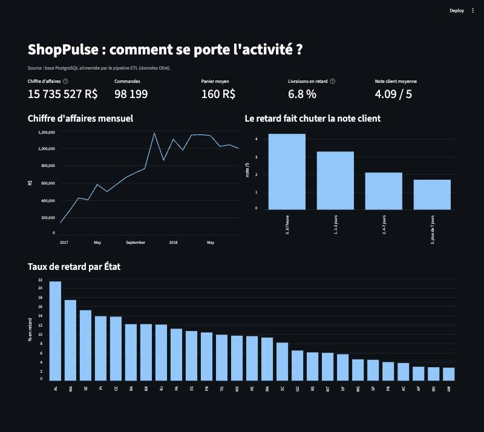

# ShopPulse : plateforme data & IA

Mission de 10 jours pour ShopPulse, une marketplace e-commerce. Les données
viennent du jeu public [Olist](https://www.kaggle.com/datasets/olistbr/brazilian-ecommerce),
soit environ 100 000 commandes.

> En cours. Les lots 1 (cadrage), 4 (modèles) et 5 (API) restent à livrer.

## Démarrage rapide

Prérequis : [uv](https://docs.astral.sh/uv/), Docker et `make`.

```bash
make install   # dépendances + création de .env (à adapter)
make db        # PostgreSQL 16 dans Docker
make etl       # charge data/raw/ (ou data/sample/ si RAW_DIR=data/sample)
make test      # tests unitaires + tests de données
make dashboard # tableau de bord Direction sur http://localhost:8501
```

Les 9 CSV Olist sont à déposer dans `data/raw/`. Ce dossier n'est pas versionné.
Pour essayer sans télécharger le jeu complet, on peut utiliser l'échantillon
versionné : `RAW_DIR=data/sample make etl`.

## Données fiables (Lot 2)

| Livrable | Emplacement |
|---|---|
| Modèle relationnel (MLD) | [`docs/mld.md`](docs/mld.md), [`sql/schema.sql`](sql/schema.sql) |
| Pipeline ETL orchestré (Prefect) | [`pipelines/etl_flow.py`](pipelines/etl_flow.py) |
| Règles de nettoyage traçables | [`src/shoppulse/etl/clean.py`](src/shoppulse/etl/clean.py) |
| Rapport qualité avant/après (généré) | [`docs/quality_report.md`](docs/quality_report.md) |
| 8 requêtes d'analyse documentées | [`sql/README.md`](sql/README.md), [résultats](docs/sql_results.md) |

Le pipeline se déroule ainsi : **extraction → nettoyage → contrôles bloquants → chargement**.

- Les 9 tables sont décrites une seule fois, dans
  [`specs.py`](src/shoppulse/etl/specs.py) : clé primaire, dates, domaines de
  valeurs, clés étrangères. Toutes les étapes lisent cette description.
- Chaque règle de nettoyage est une petite fonction. Le nombre de lignes ou de
  cellules qu'elle modifie est consigné dans le rapport qualité.
- Les contrôles bloquants (clés nulles, clés dupliquées, valeurs hors domaine,
  orphelins) arrêtent le pipeline **avant** que la base ne soit modifiée.
- Le chargement est **idempotent** : tout se fait dans une seule transaction
  (`TRUNCATE` puis `COPY`). Une erreur laisse la base intacte, et deux exécutions
  donnent le même contenu. La CI lance d'ailleurs le pipeline deux fois.

## Analyse et marketing (Lot 3)

| Livrable | Emplacement |
|---|---|
| EDA : distributions, saisonnalité, géographie | [`notebooks/01_eda.ipynb`](notebooks/01_eda.ipynb) |
| 2 tests statistiques motivés | même notebook, sections 5 et 6 |
| Segmentation RFM + K-means, 3 personas, 3 actions chiffrées | [`notebooks/02_segmentation.ipynb`](notebooks/02_segmentation.ipynb) |
| Tableau de bord, 5 indicateurs, branché sur la base | [`dashboards/app.py`](dashboards/app.py) |

### Réponses métier

- **Comment se porte l'activité ? (Direction)** Le chiffre d'affaires est de 15,7 M R$ sur environ
  98 000 commandes, avec un panier moyen de 160 R$. 6,8 % des livraisons arrivent en retard, et la
  note moyenne est de 4,1/5.
- **Que disent les clients ? (Service client)** Le retard fait chuter la note : 4,3/5 pour une
  commande à l'heure, 1,7/5 au-delà de 7 jours de retard. Un test de Mann-Whitney le confirme
  (p ≈ 0, effet fort, r = 0,64).
- **Où sont les retards ? (Logistique)** Le Nordeste subit 2 fois plus de retards que le Sud
  (12,7 % contre 5,9 %). Un χ² confirme le lien avec la région (p ≈ 10⁻¹²⁰).
- **Qui sont nos clients ? (Marketing)** 97 % des clients n'achètent qu'une fois. On distingue
  3 personas :

  | Persona | Clients | Action | Gain estimé |
  |---|---|---|---|
  | Récents | 35 % | -10 % sur un 2e achat, 30 jours après la livraison | ≈ 260 k R$ |
  | Endormis | 62 % | Réactivation à -15 % pendant 15 jours | ≈ 154 k R$ |
  | Fidèles | 3 % | Club fidélité avec livraison offerte | ≈ 73 k R$ |

  Ces trois actions rapporteraient environ 490 k R$, et le taux de réachat passerait de 3 % à 6 %.
  Les hypothèses de conversion restent à valider par un test A/B.



## Qualité du code

- Le code est organisé en package `src/shoppulse`. Il est typé (`mypy --strict`)
  et vérifié par ruff, qui applique PEP 8 et l'ordre des imports.
- Les tests utilisent pytest, avec une couverture minimale de 50 % imposée par la CI.
  Les tests de données tournent sur la base chargée.
- La CI GitHub Actions comprend trois jobs : lint, tests sur une base PostgreSQL
  alimentée par l'échantillon, puis build de l'image Docker.

## Arborescence

```
dashboards/    tableau de bord Streamlit et capture
data/sample/   échantillon (< 1 Mo par fichier), généré par make sample
docs/          MLD, rapport qualité, résultats SQL
infra/         Dockerfile, docker-compose
notebooks/     EDA, tests statistiques, segmentation
pipelines/     flows Prefect et scripts de génération
sql/           schéma et requêtes d'analyse
src/shoppulse/ package Python
tests/         tests unitaires et tests de données
```
