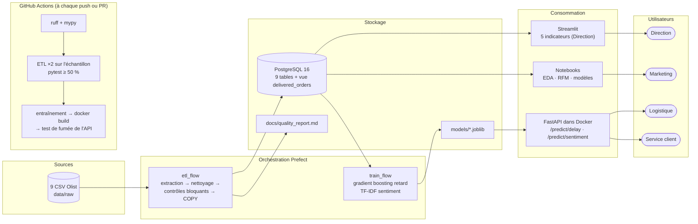

# Architecture cible

## Principes

| Principe | Mise en œuvre |
|---|---|
| **Une seule source de vérité** | Les 9 tables sont décrites une fois ([`specs.py`](../src/shoppulse/etl/specs.py)). Le retard est défini une fois (vue `delivered_orders`), et les features une fois ([`features.py`](../src/shoppulse/features.py)) pour l'entraînement comme pour l'API. |
| **Pipeline rejouable** | Le chargement est transactionnel (`TRUNCATE` puis `COPY`) : deux exécutions donnent la même base. Toute donnée dérivée (base, rapport, échantillon, modèles) est produite par un flow, jamais à la main. |
| **Logique hors de l'orchestrateur** | Les flows Prefect ne font qu'assembler des fonctions du package `shoppulse`. Ces fonctions sont testées sans Prefect, ce qui rend la migration vers Airflow peu coûteuse. |
| **API autonome** | L'artefact embarque le modèle, le seuil et les tables vendeurs et codes postaux. L'API ne dépend pas de la base et peut être déployée seule. |
| **Données sensibles hors du dépôt** | `data/raw/`, `.env` et `models/` sont ignorés par git. Seul un échantillon de moins de 1 Mo par fichier est versionné, et il sert à la CI. |

## Composants et ports

| Service | Lancement | Port |
|---|---|---|
| PostgreSQL | `make db` | 5432 |
| ETL | `make etl` | – |
| Entraînement | `make train` | – |
| API | `make api` (Docker) | 8000, documentation sur `/docs` |
| Tableau de bord | `make dashboard` | 8501 |
