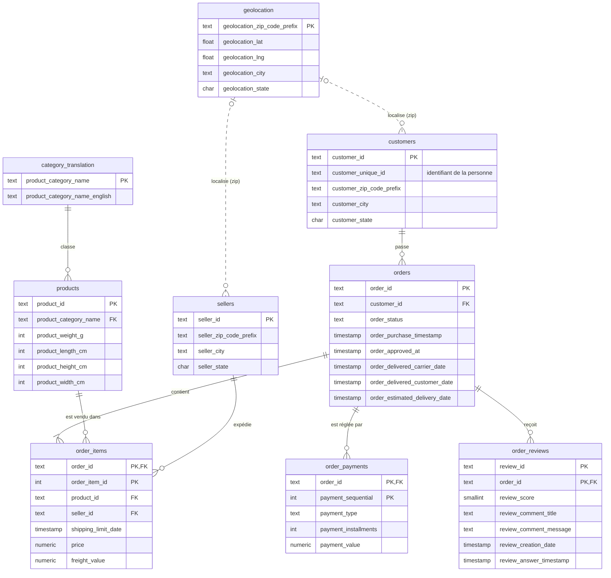

# Modèle logique de données (MLD)

Le schéma physique est dans [`sql/schema.sql`](../sql/schema.sql). Il est créé
et rechargé par le pipeline ([`pipelines/etl_flow.py`](../pipelines/etl_flow.py)).

## Choix de modélisation

| Choix | Justification |
|---|---|
| `customer_id` est la clé de `customers`, et `customer_unique_id` reste un attribut | Olist crée un `customer_id` à chaque commande. La personne réelle est `customer_unique_id`, et c'est la clé à utiliser pour le RFM et le réachat. |
| Clé composite `(review_id, order_id)` | `review_id` n'est pas unique dans la source : un même avis peut porter sur plusieurs commandes. |
| `geolocation` est agrégée à un point par préfixe postal | La source contient environ 1 M de points, avec beaucoup de doublons pour un même préfixe. On garde la médiane, qui résiste aux points aberrants. |
| Pas de clé étrangère entre le code postal et `geolocation` | Certains préfixes de clients ou de vendeurs n'ont pas de coordonnées. Imposer la contrainte ferait perdre des clients réels. On fait donc une jointure externe (`LEFT JOIN`). |
| La catégorie inconnue d'un produit devient NULL | Deux catégories (13 produits) n'existent pas dans la table de traduction. On garde le produit et on vide seulement sa référence. Cette règle est tracée dans le rapport qualité. |
| Colonnes `*_lenght` renommées en `*_length` | La faute de frappe vient de la source et est corrigée à l'extraction. |
